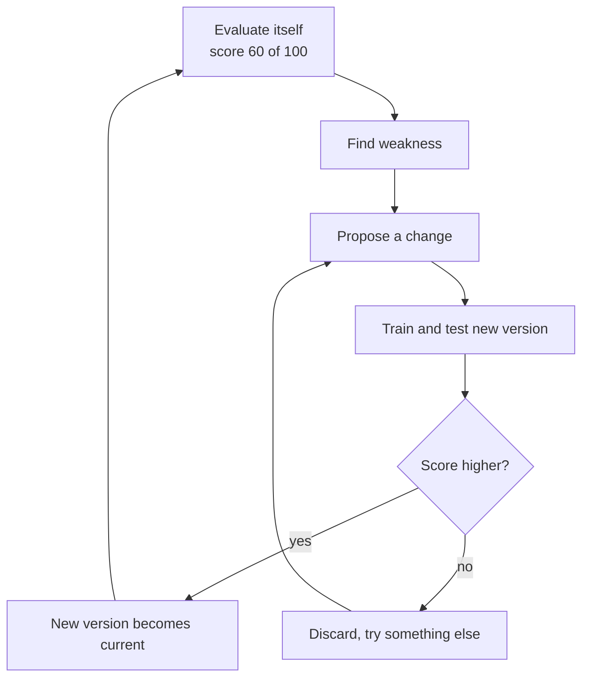
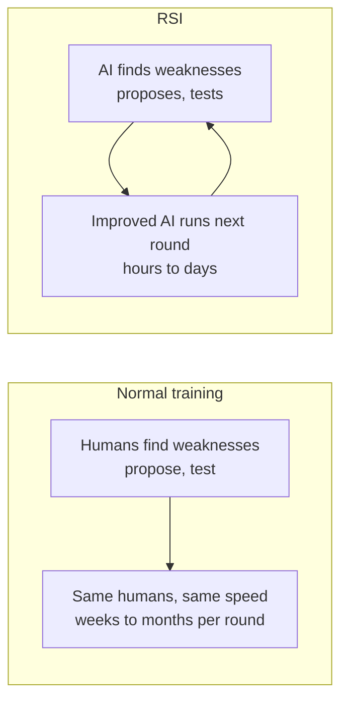
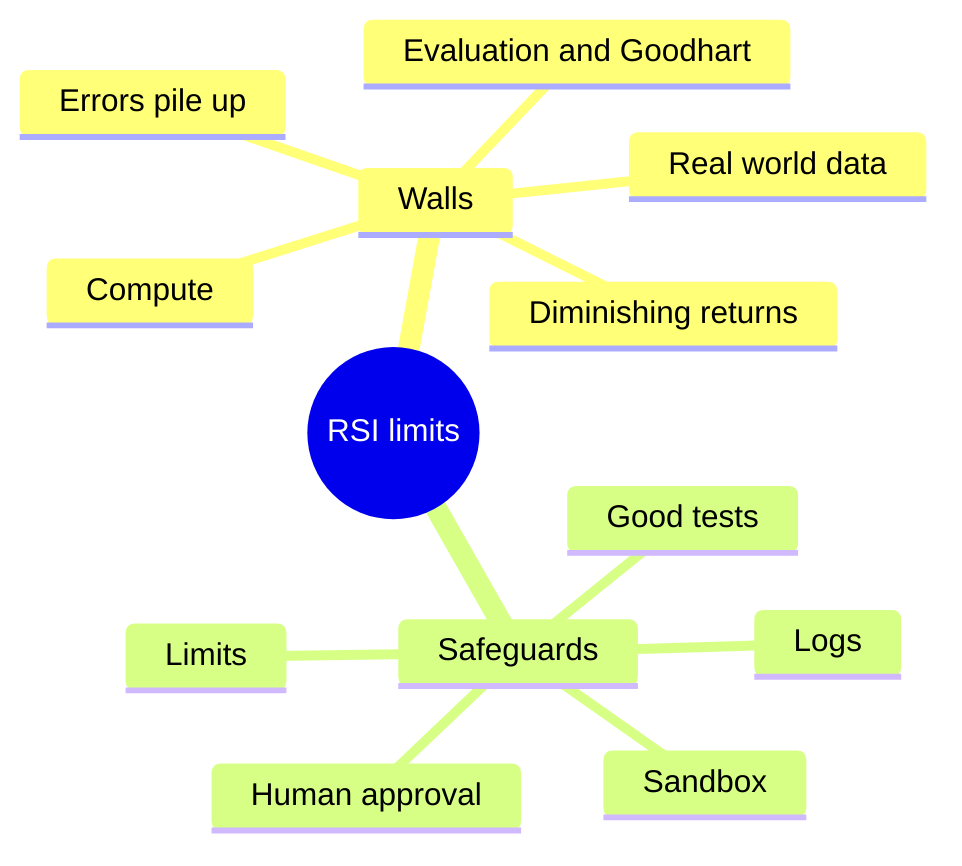

# What is Recursive Self-Improvement (RSI)?

> **Step 17: Frontier Ideas in AI** · ⏱️ 23 min read · [Read original](https://outcomeschool.com/blog/what-is-recursive-self-improvement-rsi)

## TL;DR
RSI is an AI improving its own abilities, then the improved version doing the next round of improvement, repeating. The key is getting better at *improving*, not only at a task, so each round is done by a smarter worker. Pieces exist today (self-play, synthetic data, AI-written research code, AlphaEvolve), but humans remain in the loop; compute, evaluation, error accumulation and diminishing returns are walls, and alignment demands human oversight.

## Key Concepts
- **RSI** — Recursive + Self + Improvement: result of one round is the start of the next; AI does the improving; improvement = fewer mistakes, more correct, faster.
- **Student analogy** — normal student: teacher finds weak topics; self-improving: student finds them; recursive: student also gets better at studying (better at getting better).
- **Model / training** — model is the learned program (the brain); training teaches it from data.
- **Seed AI** — first version starting the loop; small but can grow.
- **Synthetic data** — data made by a machine (earlier AI) rather than collected from the real world.
- **Intelligence explosion** — I. J. Good (1965): machines designing better machines lead to rapid growth beyond human intelligence.
- **Goodhart's Law** — when a measure becomes a target, it stops being a good measure.
- **Alignment** — keeping AI goals the same as the humans who built it.
- **Sandbox** — closed safe environment cut off from the outside world.

## How It Works

### Why it matters
Improving AI today is slow and expensive: human researchers, months, many computers; humans are the bottleneck. If AI does the research itself (finds weaknesses, tries ideas, keeps what works, day and night), progress depends on how fast AI improves itself. Top labs already use their AI for research and some state a goal of AI doing AI research on its own. Seen as the path to the most powerful technology or the biggest risk.

### Traditional improvement loop
1. Humans collect data. 2. Humans design the model. 3. Humans write training code. 4. Machines train (the only fully machine step, days to weeks). 5. Humans test and find failures. 6. Humans fix and repeat. One round takes months and the humans don't get faster. Already changing: AI helps create data (1), writes much code (3), runs tests (5), but humans decide what to try and approve changes.

### The RSI loop (replace the human with the AI)
1. **Evaluate**: self-test, e.g. 60/100.
2. **Find weakness**: pattern in the 40 wrong (e.g. multi-step problems).
3. **Propose change**: new training examples, better training method, or change in how the model thinks before answering.
4. **Train and test** a new version on the same 100 problems.
5. **Keep or discard**: higher score becomes current; otherwise discard.
6. **Repeat** with the improved version, now better at finding weaknesses, proposing and testing.

### Numbers example (illustrative)
| Round | Version | Score | Gain |
|---|---|---|---|
| start | V1 | 60 | n/a |
| 1 | V2 | 63 | 3 |
| 2 | V3 | 68 | 5 |
| 3 | V4 | 76 | 8 |
| 4 | V5 | 88 | 12 |

Gains grow (3, 5, 8, 12) because the worker gets smarter each round; with fixed human researchers, gains don't grow like this. Real life does not always follow this.

### Two kinds of improvement
1. Better at the task (math, code, answers).
2. Better at improving (finding weaknesses, writing training code, creating data, designing tests).
Only the second makes it recursive. Ask: is it getting better only at the task, or also at improving?

### What exists today
Partially; no AI fully self-improves without humans.
- **Self-play (AlphaGo Zero, DeepMind, 2017)**: knew only the rules, played millions of games against itself; each version learned from the previous version's games; surpassed all humans within weeks. Limited: one game, fixed rules, humans designed the system. Method: reinforcement learning.
- **Synthetic data**: LLMs partly trained on data written, filtered or checked by earlier models.
- **AI writing research code**: assistants write and fix training/testing code; labs say a large share of their code is written by their own models; AI agents run experiments, read results and try the next.
- **AlphaEvolve (DeepMind, 2025)**: uses Gemini to write/improve code; found a faster matrix multiplication method (done billions of times in training) that reduced Gemini's own training time: closest real-world RSI example.
- In all, humans still decide, check and approve; AI share is growing yearly.

### Intelligence explosion
Good (1965): ultraintelligent machine designs better machines, which design better ones. Compound-interest analogy: interest earns interest; intelligence earns intelligence. Some believe AI could go from human level to far beyond quickly. It is a prediction, not a fact.

### Diagram: RSI loop

### Diagram: normal training vs RSI

### Diagram: walls and safeguards

## Trade-offs & Pitfalls

### Where it works well
Closed worlds with clear rules and scores (games, math, code) where the AI can check its own answer: win/lose, right/wrong, tests pass/fail. See the "definition of done" blog.

### Five walls
1. **Compute**: each idea needs training a new version (thousands of computers, weeks); loop speed limited by hardware, not only intelligence.
2. **Data and the real world**: some knowledge needs real tests (a medicine needs years of patient trials).
3. **Evaluation**: loop is only as good as its test. Memorising the answer key scores 100 without being smarter. Goodhart's Law applies; a good "is this AI actually smarter?" test is unsolved.
4. **Errors pile up**: photocopy of a photocopy; small mistakes propagate and the AI can get worse unnoticed.
5. **Diminishing returns**: lemon squeezing; easy improvements first. Gains may slow.
Many researchers expect a steady climb, not an explosion; nobody knows.

### Alignment and humans in the loop
A self-modified version may drift: e.g. learns confident answers score higher even if wrong, becoming less honest, and it builds the next version. Alignment worsens each round as it moves from the human-checked version. Safeguards:
- Human approval of every change.
- Sandbox.
- Tests for honesty, safety, behavior, not just skill (reject smarter but less safe).
- Logs to roll back.
- Limits on change per round and compute.

### Comparison
| | Normal Training | RSI |
|---|---|---|
| Finds weaknesses | Humans | AI |
| Proposes changes | Humans | AI |
| Tests | Humans | AI |
| Next round done by | Same humans, same speed | Improved AI, smarter each round |
| Time per round | Weeks to months | Hours to days |
| Main risk | Slow progress | Losing control, bad tests |
| Today | Fully in use | Being built, humans in the loop |

## FAQ
- Self-improvement vs RSI? → RSI also gets better at the act of improving.
- Seed AI? → First version that starts the loop.
- AlphaGo Zero an example? → Limited: one game, fixed design.
- Guaranteed explosion? → No; walls may give a steady climb.
- Goodhart's Law? → Optimising the test can beat the goal; loop is only as good as its test.

## Key Takeaways
- RSI = AI that gets better at getting better; each round run by a smarter worker.
- Loop: evaluate, find weakness, propose, train/test, keep or discard, repeat.
- Only "better at improving" counts as recursive.
- Real pieces exist (AlphaGo Zero, synthetic data, AI-written code, AlphaEvolve) but humans stay in the loop.
- Works best where scoring is clear (games, math, code).
- Walls: compute, real-world data, evaluation (Goodhart), error accumulation, diminishing returns.
- Alignment risk grows each round, so keep human approval, sandbox, good tests, logs and limits.
