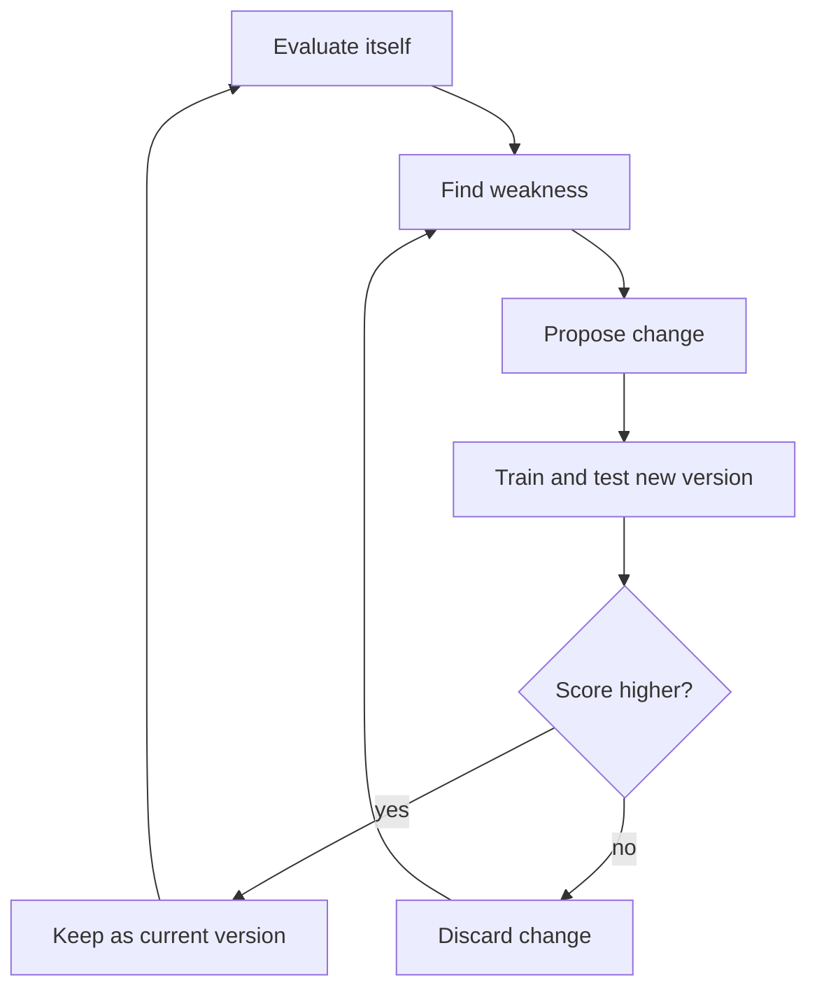

# What is Recursive Self-Improvement (RSI)?

> **Step 17: Frontier Ideas in AI** · ⏱️ 23 min read · [Read original](https://outcomeschool.com/blog/what-is-recursive-self-improvement-rsi)

## TL;DR
Recursive Self-Improvement is an AI improving itself, with the improved version then doing the next round of improvement. Its distinguishing feature is getting better at getting better; today only pieces of the loop exist, always with humans in the loop.

## Key Concepts
- **Recursive Self-Improvement (RSI)** — AI improves its abilities, and the improved version improves itself further, repeatedly.
- **Two kinds of improvement** — better at the task vs better at improving; only the second makes the loop recursive.
- **Seed AI** — the small first version that starts the loop.
- **Intelligence explosion** — I. J. Good's 1965 idea: better machines design better machines, leaving humans behind.
- **Goodhart's Law** — when a measure becomes a target, it stops being a good measure.
- **Alignment problem** — keeping the AI's goals matched to its builders' goals.

## How It Works
**Traditional improvement:** humans collect data, design the model, write training code, train (the only machine-only step), test, fix and repeat. A round takes months and the humans stay equally fast. AI already helps (synthetic data, code, tests) but humans still decide and approve.

**RSI loop:** (1) evaluate itself, (2) find the weakness, (3) propose a change, (4) train and test the new version, (5) keep it only if the score rises, (6) repeat with the improved version as the worker.

**Numbers example (illustrative):** score 60, then gains of 3, 5, 8, 12 per round, since a smarter worker finds bigger improvements. Like compound interest for intelligence.

**What exists today (humans still in the loop):** AlphaGo Zero self-play (2017, closed game rules); synthetic training data from earlier models; AI writing research code; AlphaEvolve (2025) found a faster matrix multiplication method, the closest example.

**Where it works:** closed worlds with clear scoring (games, math, code).

**Five walls**
1. Compute — testing ideas still needs training runs.
2. Real-world data — e.g. medicine trials cannot be skipped by thinking.
3. Evaluation — a loop is only as good as its test; models can game it.
4. Errors pile up — photocopy-of-a-photocopy effect.
5. Diminishing returns — easy gains come first (lemon squeezing).

**Keeping humans in the loop:** human approval of changes, sandbox, tests for honesty and safety (not just skill), logs to roll back, limits on change size and compute.

| | Normal Training | RSI |
|---|---|---|
| Who finds, proposes, tests | Humans | The AI |
| Next round done by | Same humans, same speed | Improved AI |
| Round time | Weeks to months | Hours to days |
| Main risk | Slow progress | Losing control, bad tests |

## Diagram

## Key Takeaways
- RSI means the AI gets better at getting better, not just better at a task.
- The full autonomous loop does not exist yet; self-play, synthetic data, AI-written code, and AlphaEvolve are partial pieces.
- Intelligence explosion is a prediction, not a fact; compute, real-world data, bad tests, error build-up, and diminishing returns may make it a steady climb.
- The loop is only as good as its evaluation (Goodhart's Law).
- Alignment gets harder each round, so keep human approval, sandboxes, logs, and limits.
